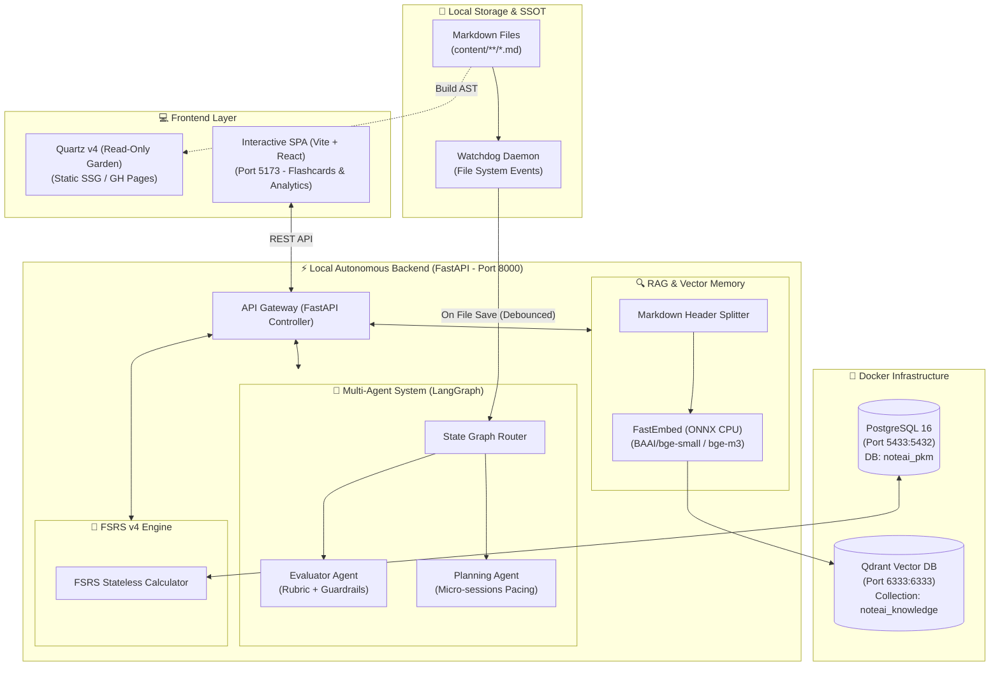
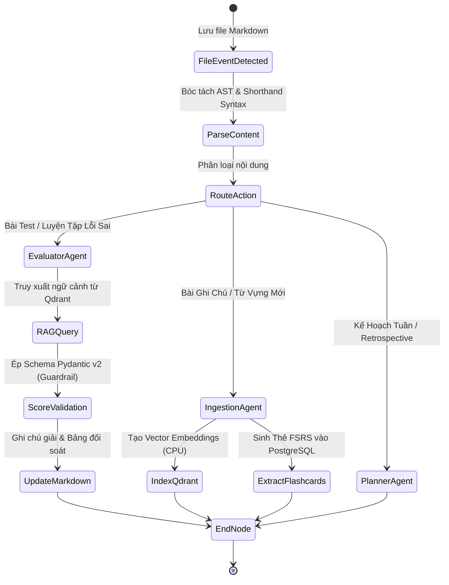
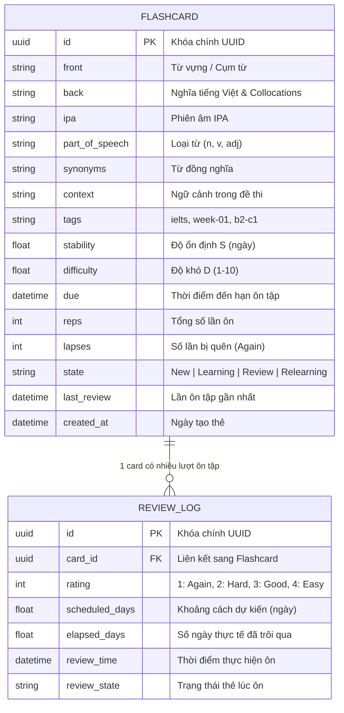
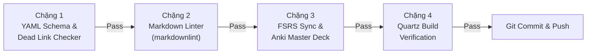

# 🏛️ ĐẶC TẢ KIẾN TRÚC KỸ THUẬT: NOTEAI.V2 (LOCAL AUTONOMOUS PKM)

Tài liệu này đặc tả toàn diện kiến trúc kỹ thuật của hệ thống **NoteAI.v2** — Hệ thống Quản trị Tri thức Cá nhân Tự trị (**Local Autonomous PKM & Digital Garden**) phục vụ luyện thi IELTS, kết hợp giữa mô hình Web Tĩnh (Static Site) và Hệ sinh thái AI Kỹ thuật cao (AI Engineering & Backend Architecture).

---

## I. TỔNG QUAN HỆ THỐNG & TRIẾT LÝ THIẾT KẾ (SYSTEM VISION)

### 1. Triết Lý Cốt Lõi: Hybrid Dual-Engine

- **Engine 1 - Static Knowledge Garden (Read-only):** Sử dụng **Quartz v4** (TypeScript, Preact, Unified AST). Phục vụ việc duyệt web siêu tốc, xem biểu đồ liên kết kiến thức (Interactive Knowledge Graph) và xuất bản tự động lên GitHub Pages.
- **Engine 2 - Local Autonomous Runtime (Read-Write / AI-powered):** Sử dụng **FastAPI**, **LangGraph**, **Qdrant**, **PostgreSQL**, **FSRS v4** và **Vite React SPA**. Phục vụ các tác vụ tương tác: lật flashcard theo thuật toán DSR, đối soát bài thi IELTS qua AI, lập kế hoạch học tập thích ứng (Adaptive Pacing) và giám sát viễn trắc (MLOps Telemetry).

### 2. Nguyên Tắc Thiết Kế (Architectural Principles)

1. **Single Source of Truth (SSOT):** Toàn bộ tri thức (bài làm, từ vựng, tài liệu) lưu trữ dưới dạng Markdown trong thư mục `content/`. Các cơ sở dữ liệu (PostgreSQL, Qdrant) và trang web tĩnh chỉ là các **dẫn xuất tự động (Artifacts)**.
2. **Local-First & Hardware-Safe:** Lưu trữ dữ liệu 100% tại máy chủ cục bộ. Toàn bộ pipeline vector nhúng chạy tối ưu trên CPU bằng tập lệnh AVX2/AVX-512 để không tiêu tốn 4GB VRAM của card đồ họa rời NVIDIA T1200.
3. **Formal Verification (Fail-fast):** Áp dụng pipeline kiểm chứng 4 chặng trước khi cho phép Git commit để đảm bảo không bao giờ tồn tại broken links hoặc lỗi cú pháp YAML Frontmatter.
4. **Idempotence & State Isolation:** Mọi tác vụ đồng bộ và trích xuất dữ liệu có thể thực thi nhiều lần mà không làm nhân bản bản ghi hoặc thay đổi trạng thái không mong muốn.

---

## II. SƠ ĐỒ CẤU TRÚC TỔNG THỂ (SYSTEM TOPOLOGY)



---

## III. BẢN ĐỒ CỔNG MẠNG & HẠ TẦNG (NETWORK SPECIFICATION)

Để tránh xung đột với các tiến trình và container khác đang chạy trên hệ thống:

| Dịch vụ              | Host Port | Container Port | Mục đích kỹ thuật                             | Ghi chú an toàn                                      |
| :------------------- | :-------: | :------------: | :-------------------------------------------- | :--------------------------------------------------- |
| **PostgreSQL 16**    |  `5433`   |     `5432`     | Lưu trữ thẻ Flashcard & Review Logs (FSRS v4) | **Tuyệt đối không dùng 5432** (cvat_db đang sử dụng) |
| **Qdrant Vector DB** |  `6333`   |     `6333`     | REST API tìm kiếm ngữ nghĩa tri thức          | Port `6334` dùng cho gRPC nội bộ                     |
| **FastAPI Backend**  |  `8000`   |       -        | REST API Gateway & Multi-Agent Engine         | Swagger UI tại `/docs`                               |
| **Interactive SPA**  |  `5173`   |       -        | Giao diện React/Vite (Flashcards & Dashboard) | Chạy dev server qua Vite                             |
| **Quartz v4**        |  `8088`   |       -        | Web tĩnh Digital Garden xem trước cục bộ      | Mặc định xuất bản lên GitHub Pages                   |

---

## IV. KIẾN TRÚC ĐA ĐẶC VỤ & LUỒNG XỬ LÝ SỰ KIỆN (EVENT-DRIVEN MULTI-AGENT)

### 1. Luồng Bắt Sự Kiện (Watchdog Event Pipeline)

1. Người học lưu bài làm hoặc thêm từ vựng mới vào `content/**/*.md`.
2. `Watchdog` daemon bắt sự kiện `FileModifiedEvent` (áp dụng cơ chế Debounce 1.5 giây để tránh kích hoạt liên tục khi đang soạn thảo).
3. Đẩy payload vào **FastAPI Background Tasks**.
4. Khởi chạy luồng điều phối của **LangGraph State Machine**.

### 2. Sơ Đồ Máy Trạng Thái LangGraph



### 3. Pydantic v2 Structured Guardrails

Toàn bộ output của Evaluator Agent phải được validate nghiêm ngặt qua Schema:

```python
class TestQuestionResult(BaseModel):
    question_number: int
    user_answer: str
    correct_answer: Optional[str] = None
    is_correct: Optional[bool] = None
    trap_type: Optional[str] = None
    explanation: Optional[str] = None

class EvaluationOutput(BaseModel):
    score_fraction: Optional[str] = None  # Ví dụ: "22/40" (chỉ có khi đủ key)
    band_score: Optional[float] = None
    strengths: List[str]
    weaknesses: List[str]
    questions: List[TestQuestionResult]
    recommended_micro_drills: List[str]
```

> [!CRITICAL]
> **Guardrail Check:** Nếu `correct_answer` là `None`, trường `is_correct` bắt buộc phải là `None`. Tuyệt đối ngăn chặn Agent tự ý phán đoán kết quả Đúng/Sai.

---

## V. ĐỘNG CƠ LẶP LẠI NGẮT QUÃNG FSRS V4 (SPACED REPETITION ENGINE)

### 1. Nền Tảng Lý Thuyết: Mô Hình DSR

Thuật toán FSRS v4 mô hình hóa trí nhớ con người qua 3 biến số toán học:

- **Difficulty ($D \in [1, 10]$):** Độ khó nội tại của khái niệm/từ vựng.
- **Stability ($S > 0$ ngày):** Độ ổn định của trí nhớ; là số ngày để xác suất nhớ lại giảm còn 90%.
- **Retrievability ($R \in [0, 1]$):** Xác suất người học nhớ lại khái niệm tại thời điểm $t$:
  $$R(t, S) = \left(1 + \text{factor} \cdot \frac{t}{S}\right)^{-0.5}$$

### 2. Sơ Đồ Cơ Sở Dữ Liệu Quan Hệ (SQLModel / PostgreSQL 3NF)



---

## VI. PIPELINE TRUY XUẤT NGỮ NGHĨA VECTOR RAG (CPU-OPTIMIZED)

### 1. Kỹ Thuật Chunking

- Sử dụng `MarkdownHeaderTextSplitter` kết hợp bảng phân tích AST.
- Giữ nguyên cấu trúc phân cấp: Heading 1 (`#`), Heading 2 (`##`), Heading 3 (`###`).
- Giữ nguyên vẹn toàn bộ Markdown Table (Bảng từ vựng, Bảng đối soát lỗi) và Code block, không để thuật toán cắt ngang giữa bảng.

### 2. Bộ Nhúng FastEmbed & Cơ Sở Dữ Liệu Qdrant

- **Engine:** `fastembed` (Rust core, ONNX Runtime).
- **Mô hình nhúng:** `BAAI/bge-small-en-v1.5` (chiều vector: 384) hoặc `BAAI/bge-m3` (chiều vector: 1024).
- **Khoảng cách vector:** Cosine Distance.
- **Cấu hình chỉ mục HNSW:** $m=16$, $ef\_construct=100$.
- **Payloads lọc đa chiều:** `file_path`, `heading_path`, `skill`, `cefr_level`, `tags`.

---

## VII. KIẾN TRÚC BACKEND API & FRONTEND SPA

### 1. Backend Controller - Service - Repository Pattern

- **API Routers (Controllers):** Nhận HTTP Request, validate dữ liệu qua Pydantic schemas, gọi tầng Service và trả về response chuẩn JSON.
- **Services Layer:** Triển khai nghiệp vụ độc lập: `FSRSService`, `RAGEngine`, `LangGraphEngine`, `MarkdownParser`.
- **Repository / Database Layer:** SQLModel kết nối PostgreSQL pool, quản lý session bất đồng bộ (`async_sessionmaker`).

### 2. Frontend React 19 Interactive SPA

- **Công nghệ:** Vite + React 19 + TypeScript + Tailwind CSS + TanStack Query + Lucide Icons + Recharts.
- **Module Flashcard Player:** Lật thẻ 3D, hỗ trợ phím tắt (`Space`, `1`, `2`, `3`, `4`), hiển thị trước khoảng cách lặp (Next Interval) trên từng nút.
- **Module Analytics:** Biểu đồ tỷ lệ ghi nhớ (Retention Curve), Heatmap lịch học, biểu đồ tiến độ điểm thi Listening/Reading.

---

## VIII. PIPELINE KIỂM CHỨNG HÌNH THỨC (FORMAL VERIFICATION)

Hệ sinh thái duy trì tính toàn vẹn thông qua script điều phối `scripts/run_pipeline.py`:



Mọi thay đổi vi phạm (liên kết chết, schema sai lệch, bảng vỡ) sẽ lập tức dừng tiến trình và trả về mã lỗi không cho phép commit vào git.
